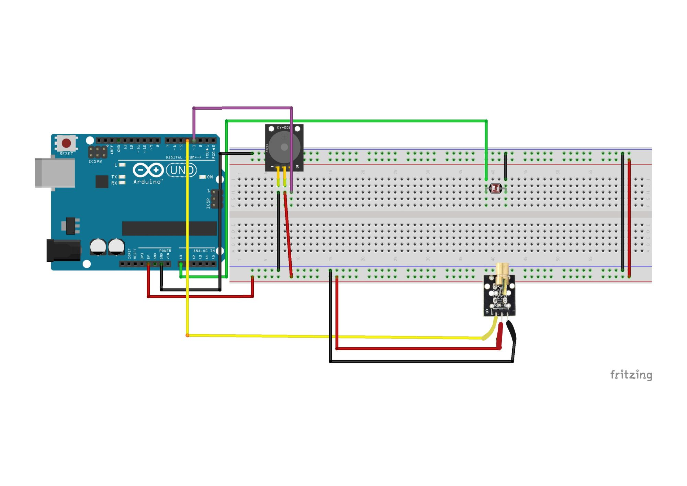

# Security Alarme Arduino Project

## Overview

In this project, you will see how to build a simple laser alarm system using an Arduino UNO, a photoresistor, a laser pointer, a buzzer, and a breadboard. When the laser point is on, the photoresistor detects the change in light intensity, and the Arduino activate the buzzer as an alarm. This project is ideal for learning about basic security systems and sensor integration with Arduino.

## Components Used

- Arduino UNO
- Breadboard
- Photoresistor
- Laser pointer
- Buzzer
- Resistors
- wires

## Wiring Diagram

See the image above for the complete wiring schematic.

## Installation

1. Assemble the circuit as shown in the wiring diagram ('Shema').
2. Position the laser pointer so its beam hits the photoresistor directly.
3. Download this repository.
4. Install the Arduino IDE from [arduino.cc](https://www.arduino.cc/en/software).
5. Connect the Arduino UNO to your PC via USB.

## Usage

1. Upload the Arduino code to your board.
2. Power the circuit.
3. When the laser is not pointed on the photoresistor (by a person passing through), the photoresistor will detect a change in the light intensity, activating the buzzer alarm.

## Example Arduino Sketch

Check the code in the file: Alarme_security/Alarme_security.ino

## Dependencies

- Arduino IDE

## Credits

Wiring diagram created with Fritzing.
